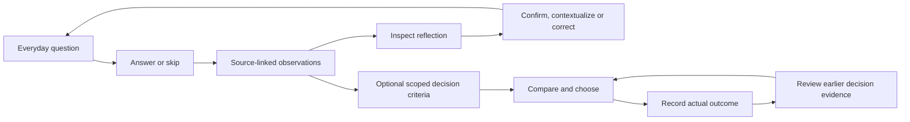
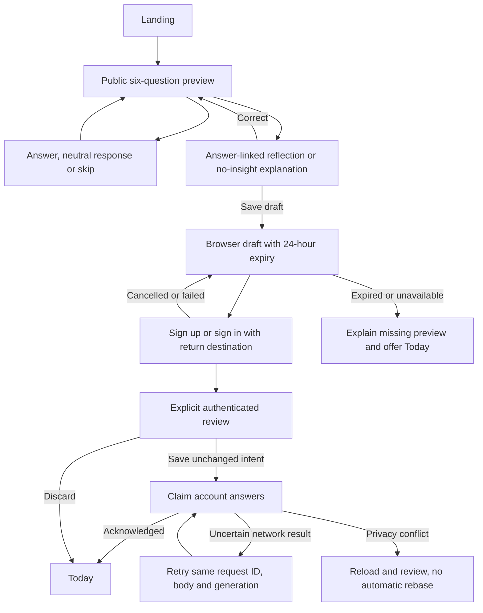
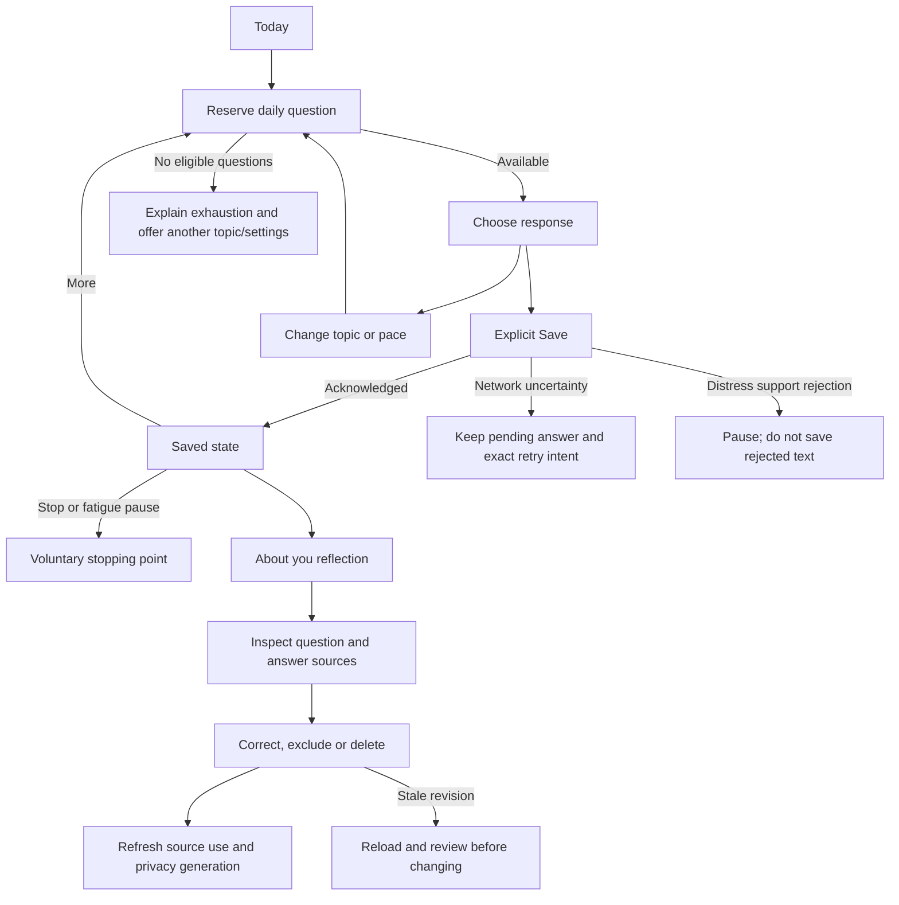
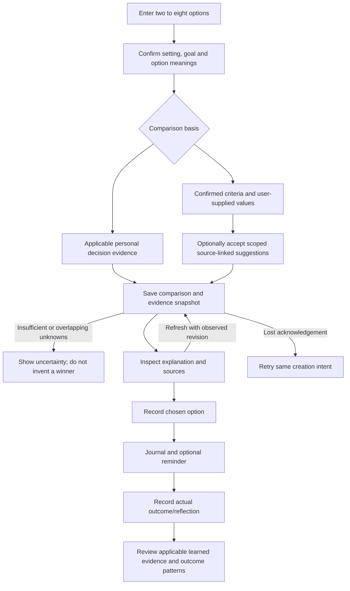
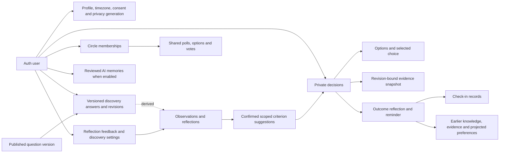

# Phase 1 — reverse-engineering the existing Nudge web app

8 November 2026. Deliverable: source-based product, route, flow, data/API and design inventory. This phase changes documentation only. Mobile adaptation decisions belong to Phase 2; research, visual directions and UI implementation are not approved by this document.

Reading this as: self-discovery through everyday questions, with decision help grounded in people's answers, for people exploring their preferences, using a calm, approachable language built around Nudge's existing blue identity.

## 1. Evidence and scope

| Label | Meaning in this inventory |
| --- | --- |
| Observed in source | Read directly in the current web/native checkout, static question files, route handlers, services, components or database migrations. It does not establish deployed or installed behavior. |
| Inferred | Product importance, likely audience or usability implications inferred from source prominence. Not analytics, user research or a measured engagement effect. |
| Recorded earlier | Existing verification reports/logs. Kept separate from checks performed in this phase. |
| Unverified | Current hosting configuration, new adapters' deployment, current installed Android behavior, native screenshots, screen-reader speech, device performance and actual user behavior. |

| Source of truth | Inspected material / boundary |
| --- | --- |
| Product routes | All current `src/app/**/page.tsx` routes, their main client components and public/auth/app shells. `/auth/callback` is a transport route, not a screen. |
| Behavior and data | `src/lib/discovery/*`, `src/lib/services/*`, `src/lib/api/v1/*`, migrations through `00019`, web action/RPC entry points. No credentials or private user records were read for this audit. |
| Visual implementation | `src/app/globals.css`, `src/components/app/workspace.css`, landing CSS, shared UI primitives, root/auth/app font imports and navigation. These support a design inventory, not visual acceptance. |
| Native implementation | Current `mobile/App.tsx`, discovery/decision/account/tools components and clients, theme/core copies, existing APK metadata and parity/verification records. Source wiring is not proof that a downloadable build contains it. |
| Live site / people | No live walkthrough or user study in this phase. The previous emulator walkthrough was interrupted before usable app screenshots were captured. |

The latest delivered standalone APK is 0.2. Newer comparison/journal/account/tools source exists and is wired into the native shell, but no new verified release APK or deployment proof is established here. Parts of `PARITY.md` still describe those newer features as pending; this inventory identifies that documentation drift rather than treating either status as runtime evidence.

## 2. Product, audience and repeat loop

| Aspect | Existing behavior | Evidence / qualification |
| --- | --- | --- |
| Purpose | Learn from light answers; show inspectable reflections; help with later decisions using applicable evidence or explicit criteria. | README, landing, Today, About you and comparison services. |
| Audience | People who want to explore preferences and make choices with more personal context. | Inferred from the product entry point and vocabulary. No validated persona, usage segment or retention claim. |
| First value | Six public questions and a few answer-linked reflections before account creation. | `/start`, preview component and shared observation rules. Neutral answers do not justify fixed traits. |
| Repeat loop | Open Today → answer or skip → inspect a reflection when available → correct/confirm it → optionally answer more or leave. | Current daily/profile components. This is not a chat conversation or a clinical assessment. |
| Decision payoff | Enter alternatives → explain setting/meanings → review evidence/criteria → compare → choose → later reflect on the outcome. | `/ask`, `/history`, check-ins and comparison services. An unsupported winner is not a valid fallback. |
| Sharing | Separate invited decision circles and polls. | A circle is not access to another person's discovery profile or journal. |
| Revenue / launch assumptions | No pricing, AI entitlement or public-release readiness is inferred from a marketing section. | Operational capability/configuration must be verified separately. |

### Feature importance

Importance below is an inference from navigation and the intended core loop, not measured frequency.

| Rank | Features | Reason |
| --- | --- | --- |
| Core | Public preview, explicit save, Today, About you/evidence/correction, Decide and decision history/outcomes. | Entry point, main navigation and the self-knowledge-to-decision loop. |
| Supporting | Question preferences/topic/pace; reminders/check-ins; Earlier preferences; memory inspector/library; outcome patterns; circles/polls; optional starter preferences. | Personalization, revisiting and collaboration around the main loop. |
| Occasional but essential | Recovery, terms review, export, learning reset, history/account deletion, support and accessibility information. | Low frequency is inferred; these remain necessary trust/recovery paths. |
| Optional capability | AI language interpretation, reviewed memory extraction and monthly recap; browser push. | Capability and consent gated. Basic discovery and manual comparison must remain useful without them. |

## 3. Screen and route inventory

State shorthand: **L** loading/pending, **E** error/recovery, **Ø** empty/no result, **Long** lengthy content behavior. Unless stated otherwise, these are implementations found in source, not completed visual/device tests.

### Public, identity and entry

| Route / screen | Purpose and principal actions | Data and arrival | Implemented states / limits |
| --- | --- | --- | --- |
| `/` | Explain product; try working demo; start preview; sign in; process/features/FAQ/policy links. | Public landing/direct visit. | Responsive marketing layout. No private profile. Marketing modules and hover interactions are separate from the authenticated product. |
| `/start` | Six current discovery questions; choice/neutral/skip; Back; source-linked results; Save/Delete preview; existing-account route. | Landing CTA/direct. Current editioned preview catalog. | L initialization; E validation/storage; Ø skipped/context-only results; earlier-edition notice; 24-hour draft expiry. At most three reflections shown in this web result view. |
| `/signup` | Google signup; email/password signup when the public feature flag permits it; preserve intended destination. | Preview Save normally carries `next=/discovery-save`; normal signup can lead to optional foundation onboarding. | L/disabled fields; E; completion notice. Email fields can be absent. Source flag support does not verify current hosted settings or mail delivery. |
| `/login` | Google or existing email/password sign-in; signup and recovery. | Public link, protected-route redirect, preview handoff. | L/E, OAuth/link failure and deleted-account notice; allowed return destination retained. |
| `/reset-password` | Request recovery email. | Login recovery link. | L Sending, success/error notice, return to login. Delivery is external to form correctness. |
| `/update-password` | Set password in a recovery session. | Auth callback/recovery. | L Saving, E, minimum-length validation. |
| `/auth/callback` | Exchange OAuth/recovery code and choose a permitted return route. | Supabase Auth. | Transport only. Browser cookie callback is not the native PKCE exchange. |
| `/consent` | Review and accept the current Terms/Privacy version when required. | Configured app gate or explicit review. | No identity → login; accepted current version → permitted next route; form validation/error. |
| `/discovery-save` | Review the local preview; explicitly claim or discard it; continue to Today. | Authenticated preview handoff. | L, Ø expired/missing draft, E storage/conflict/save, disabled pending actions. First claim pins generation/request/body; no silent rebase after privacy changes. Web lists all preview answers here. |

### Main product and supporting screens

| Route / screen | Purpose and principal actions | Data and arrival | Implemented states / limits |
| --- | --- | --- | --- |
| `/dashboard` — Today | Daily question; topic/pace change; save; more/stop; open reflections, Decide, journal and preferences. | Default authenticated destination/main nav. | L, E+reload, unanswered/answered, explicit stop/pause and exhausted pool. Topic change reserves a question without submitting an answer. The current web still contains the copy and plain text shortcuts the owner rejected for mobile. |
| `/discover` | Compatibility redirect. | Older links. | Redirects to `/dashboard`; not another discovery experience. |
| `/profile` — About you | Reflections and evidence; feedback; correct/exclude/delete answers; question settings; legacy memory/preferences; basics/privacy/data. | Main nav, Today and source links. | Discovery L/E+Retry/Ø/mixed-evidence/status/confirmations. Server errors go to shared error boundary. Insights disclose more after an initial subset; discovery answers are not paginated in this web component. Separate older-memory controls have their own limits/pagination. |
| `/ask` — Decide | Two–eight options; setting/goal/meanings; history or criteria basis; saved setting; interpretation; compare/reasons; refresh/extra option; choose; resume/copy. | Main nav/Today/journal; `a,b,resume,copy,basis` query parameters. | Input/confirmation E, settings-pending fieldset lock, cold-start/insufficient evidence, unavailable saved evidence, criteria uncertainty, saved/open/closed states. Invalid persisted target → not found. Shared route skeleton. Long details/criteria disclosed progressively. |
| `/history` — Journal | Search/category/status filters; resume or let go; choose-again copy; rate/write outcome; reminder controls. | Sidebar/Today/check-in target `decision`. | Dedicated L; E boundary; distinct Ø no history/no matches; pages of 20; four statuses: open/decided/reflected/abandoned. URL filters preserve state. Dense pills/actions need native adaptation. |
| `/notifications` — Check-ins | Read latest check-ins; Reflect now; mark one/all read; browser push control. | Sidebar/mobile header bell/browser push target. | Shared L, E boundary, Ø; unread/read styling; latest 50 only. Dismissal marks read, not deletion of a decision. |
| `/discover/checks` — Earlier preferences | Still true / Not anymore / Forget; confirm/reject eligible inferred likes. | About you → Earlier decisions and memory. | Ø up to date, pending/disabled actions and per-action E. One verification displayed at a time from a bounded loaded set. Rejection clears an inference rather than inventing an opposite preference. |
| `/onboarding` — Optional starter preferences | Older authenticated foundation set: optional name, six questions, rationales, neutral/skip, review/edit/save or compare now. | Normal signup fallback or optional tool. | No identity → login; already completed → permitted destination. Missing/not-six catalog → unavailable without false completion. Stale-generation/save E retains current answers. **Distinct from `/start`.** |
| `/analytics` — Outcome patterns | Descriptive rating/regret/activity/category summaries; positive/regretted decisions; optional AI recap. | About you supporting link. Latest 250 decisions. | Shared L/E; separate Ø no decisions/no ratings/no reflections; 12-week activity. Chart/title hover and truncated labels are web-specific. Current causal-sounding labels need review before reuse. |
| `/groups` — Circles | List/open circles; create; join invite; copy invitation. | About you supporting link/direct invitation. | Shared L/E, Ø Start a circle; pending/error action forms. Two-column cards at larger widths. |
| `/groups/[id]` — Circle and polls | Members; owner invitation rotation/deletion; member leave; create 2–4-option poll; cast/change own vote; view totals/ties; permitted close. | Circle list/direct authorized link. | Not found for inaccessible/missing circle; separate query errors; Ø no polls/no votes; open/closed, tie/winner, own selected vote. Latest 20 polls. Typed owner-deletion confirmation. |

### Policy and nested product surfaces

| Surface | Current location / implementation | State or scope note |
| --- | --- | --- |
| Privacy, Terms, Cookies/storage, Security, Accessibility, Support | `/privacy`, `/terms`, `/cookies`, `/security`, `/accessibility`, `/support` through `(public)/[policy]/page.tsx`. | Unknown policy → not found; missing operator config → preview notice. Constrained long article. Licenses is the separate `/third-party-notices.txt` resource. |
| Answer sources/edit/delete and question preferences | Nested in About you discovery panel, including `#question-settings`. | Source and revision/generation matter; browser anchors/disclosures do not define native navigation. |
| Earlier beliefs, likes/dislikes, evidence, timeline, milestones and memory library | About you → Earlier decisions and memory. | Older learning system. Preferences query capped at 200; initial inspector shows 20 nodes; library separately paged. Do not equate its belief scores with discovery reflections. |
| Profile basics, AI/privacy and data danger zone | About you account settings / data controls. | Separate confirmation for reset/history/account deletion; account deletion needs recent verified authentication. |
| Comparison settings/editor, meaning review, criterion source notes, results/reasons/choice | Nested Decide client and shared comparison services. | Settings load lock, optional disclosures and confirmed review are functional states, not standalone routes. |
| Reflection and reminder forms | Journal decision cards/detail target. | Nullable outcome follow-ups must remain unknown until answered; scheduling and delivery are separate states. |

### Global navigation and failure states

| Source / shell | Behavior and current limitation |
| --- | --- |
| App layout | Profile existence/auth gate; current-terms gate only when public-launch configuration requires it. Desktop sidebar: Today/About you/Decide/Journal/Check-ins. Web mobile bottom bar: Today/About you/Decide; bell links check-ins. |
| Auth/public layouts | Centered sign-in card versus constrained public column, common brand/legal links; auth theme control and skip link. |
| Loading | Shared authenticated skeleton; dedicated Today/Journal/Discover loading components; pending navigation announcement and client saving states. A source loading component is not a measured navigation time. |
| Error | Shared retry boundary and error reference; many client operations show inline recovery. Its blanket copy that all decisions/learning are safe cannot be established from every unknown error and should be revised later. |
| Offline | Draft preservation and network errors exist in particular flows. No uniform route-wide offline model was found. Successful-write/failed-refresh and process interruption need installed tests. |

## 4. Primary journeys, branches and failure paths

### A. Value before account creation

The graph's preview loop ends at six items; an edge back to preview does not mean an endless onboarding session. Normal signup without a preview can instead enter the separate optional foundation flow.

### B. Daily discovery and correction

| Selection source fact | Current rule |
| --- | --- |
| Availability | Published, unanswered eligible questions; suppressed questions/muted topics/forgotten attributes and optional/text capability gates apply. |
| Novelty | Recently exposed families excluded over a 30-day window; topic runs diversified when possible. |
| Energy/depth | Light/curious/reflect mode, saved maximum depth and estimated effort influence selection. |
| Fatigue | Default pause after three session answers or two consecutive skips; explicit continuation can override that pause. |
| Exploration | 20% branch samples undercovered domains; remaining selection weights a bounded high-scoring pool. No behavioral optimization against measured drop-off was found. |
| Personalization limits | Coverage, learning needs and time/effort signals are implemented. Inferring a person's actual mood or predicting retention is not established. |

### C. Decision help and outcome learning

| Failure / trust branch | Existing handling |
| --- | --- |
| Private jargon or unknown setting | Ask for context/meanings; optional AI interpretation is a draft requiring confirmation, not verification of game or real-world facts. Domain scoping prevents similarly named activities in different settings from automatically sharing learned preferences. |
| Unknown criterion values | Represent ranges/unknown coverage. No neutral, free-cost or fabricated factual imputation. |
| Missing/foreign record or stale comparison | Owner checks/not-found/revision conflict; no unobserved overwrite. |
| Refresh or circle creation completion uncertain | Reconcile/reload before repeating a non-idempotent operation. Not every operation has creation-style retry protection. |
| Privacy reset while a write/AI task is in flight | Generation/consent guards reject obsolete state; exact guarantee depends on the particular shared RPC/service. Legacy tools' preflight checks are not atomic CAS. |
| AI unavailable | Manual option entry, discovery rules and explicit criteria remain possible. A provider failure does not justify guessing. |

## 5. Objects, relationships and permissions

Derived discovery observations above are not a separate clinical-trait table. The graph distinguishes relationships conceptually; not every arrow is a database foreign key or an unconditional learning write.

| System / entities | Ownership and interpretation |
| --- | --- |
| Auth user → `profiles` | Owner basics/time zone/consent/terms; protected counters and consent changes use constrained columns/RPCs. |
| `discovery_question_versions`; private answers, revisions, exposures, settings, feedback, receipts and optional metrics | Published catalog read versus authenticated owner RPC state. Ordinary clients do not directly mutate private discovery tables. Question version, answer revision and privacy generation are separate identities. |
| Derived observations/reflections | Retain question/family/answer/scope references and early/repeated/mixed/confirmed evidence states. Feedback and excluded/forgotten sources affect allowed use. Not a numeric psychometric confidence score. |
| Older questions/answers → knowledge nodes/edges/evidence, verification queue, preferences, forgotten keys | A second learning system remains in Earlier decisions and memory. It is not a renamed version of current discovery answers. |
| Decisions/options/reflections plus private request/evidence/settings records | Owner-scoped journal and comparison snapshots, stable creation receipts, observed refresh revision, choice/outcome/reminder fields and criterion provenance. |
| Notifications/subscriptions/delivery ledgers | In-app records versus browser device transport. Mark-read differs from deleting a decision. Delivery acknowledgement failure can cause duplicate external push. |
| Circles/members/polls/options/votes | Deliberately shared invitation/membership data. Own vote plus aggregate totals; no entitlement to another member's private profile/journal. |
| Reviewed AI memories and private usage attempts/daily totals | Explicit reviewed saves and bounded server accounting. Client app never needs administrative/provider keys. |

| Actor | Actual access |
| --- | --- |
| Visitor | Public experience and local preview; no private account save without authentication/review. |
| Signed-in user | Own answers, learning/evidence, decisions, profile, settings and data controls under RLS/RPC/service checks. |
| Circle member | Authorized membership/poll reads and permitted create/vote/leave actions. |
| Circle owner / eligible poll creator | Additional invite/circle management or poll-close permissions enforced by existing protected RPCs. |
| Scheduler / privileged server service | Accounting, enqueue/delivery jobs and final administrative deletion. Not a user-facing admin role. |

## 6. API and data-access map

| Transport | Reads | Writes / native reuse contract |
| --- | --- | --- |
| `/api/v1/discovery/profile` | Owner answers/reflections/settings/exposures/generation/capabilities. | Existing bearer-aware profile transport. |
| `/api/v1/discovery/next` | — | POST reserves a question, not an answer; request ID/generation, topic/mode/daily/change/hour/fatigue. Pause/exhausted is a valid response. |
| `/api/v1/discovery/claim`, `/answers` | — | POST six preview answers or one reserved daily answer; stable ID/body/generation. Explicit claim. |
| `/api/v1/discovery/answers/:id` | — | PATCH response/use-in-profile or DELETE; request ID, expected generation/revision. |
| Discovery `/settings`, `/insights/feedback`, `/suggestions` | — | Preferences and feedback; contextual suggestions with generation for later confirmation. Settings use generation without a request ID. |
| `/api/v1/decisions` | GET filtered, bounded journal; query/category/status/limit/offset. | POST explicitly confirmed comparison with stable creation ID. |
| `/api/v1/decisions/:id` | GET owner detail, options, outcome and validated explanation. | No generic decision PATCH/DELETE transport in this inspected family. Copy/review is not in-place editing or abandonment. |
| Decision `/:id/comparison` | — | POST refresh/add option using observed revision. Reconcile ambiguous refresh before retry. |
| Decision `/:id/choice`, `/reflection`, `/reminder` | — | Choice identity, reflection and reminder changes via shared owner-scoped services. URL owns decision identity. |
| `/api/v1/account/*` | Profile, latest check-ins, complete export. | New source: basics/timezone, AI/terms choices, learning reset, history removal, check-in mark-read and fresh-auth account deletion. Deployment/runtime not established here. |
| `/api/v1/tools/*` | Circles/detail, Earlier checks, beliefs/evidence, memory library and bounded descriptive outcomes. | New source: circle/poll/member/vote actions and earlier-memory corrections/deletion. Deployment/runtime not established here. |
| `/api/export` | Existing web cookie-oriented export sharing a service with the new account adapter. | Export v6 is independently paginated live data, not a transactional snapshot. |
| Remaining web actions/RPCs | Optional starter preferences, milestones, saved comparison presets, reviewed note intake and monthly recap; web abandonment controls. | Need explicit native parity decisions/adapters. A native Tools link alone does not implement them. |

| Cross-cutting area | Source finding / implication |
| --- | --- |
| Identity | Bearer verified using `getUser(token)`; invalid bearer never falls back to cookies. Browser cookie writes require same origin. Body identity is not authority. |
| Terms | Ordinary v1 routes enforce current terms when the configured public-launch gate requires them. Account access/export/deletion/terms review intentionally remain accessible for their owner when terms change. |
| Fresh deletion auth | Verified same token/identity and accepted AMR within ten minutes. Refreshing an old session is not a new authentication event. |
| Response contracts | Decision handlers use versioned envelopes; discovery/account/tools have separate JSON contracts. A common URL prefix does not make their payloads interchangeable. Private responses use no-store semantics. |
| Read side effects | Tools Earlier GET can refresh verification bookkeeping. Do not describe every GET as having no database effects. |
| Legacy generation | Some tools check generation before a separate existing correction RPC. This is not atomic revision CAS; current discovery protections must not be assumed universally. |
| Realtime/polling | No application realtime-channel/subscription or periodic data-polling calls found in the searched `src` tree. Request/server render plus explicit refresh/revalidation. |
| Uploads | No user avatar/file/media-upload flow found. Download/export/share and stored source URLs are different capabilities. |
| AI boundary | Server provider adapters exist for several vendors/compatible endpoints. Supported source is not a configured subscription, a usable key, verified model quality or a free price. Discovery and criteria scoring can run without runtime AI. |
| AI use and cost | Optional interpretation, reviewed memory extraction and monthly recap use accounted server AI. Consent, current terms, generation and explicit model/user/global budget configuration matter; each attempt/fallback is metered. Unknown usage/cost is not treated as free. |
| Push | Scheduled `send-checkins` worker uses browser Web Push/VAPID subscriptions and durable device leases/ACKs. In-app records can exist without push delivery. Native FCM/Expo registration/delivery is not implemented by reusing a VAPID endpoint. |

### Current question system, counted from checked-in JSON

| Catalog fact | Count / behavior |
| --- | --- |
| Current discovery catalog | 200 entries, all marked published in source; 18 domains. This status is not independent expert/clinical validation or proof of database deployment. |
| Formats | 187 choice, 4 scale, 3 ranking, 6 text. Text/optional eligibility still requires deployment capability and user setting. |
| Public preview | Six published editioned choice questions across six domains; separate preview file also contains six. |
| Historical preview definitions | Six previous definitions retained for interpreting older answers; not six extra questions to serve as novel current content. |
| Domains | Rest; time; values; relationships; work; learning; money; food; culture; play; creativity; childhood; uncertainty; community; places; movement; digital; future. Childhood/uncertainty are optional-topic groups. |
| Safety | Written answers do not automatically create personality labels. Detected distress can return support/pause without saving the rejected answer. Authored/editor-review metadata is not a validated psychology instrument. |

## 7. Existing design inventory

### Identity, colors and type

| Element | Observed implementation | Strength / weakness |
| --- | --- | --- |
| Brand | Canonical `public/brand/nudge-mark.svg`, shared Logo/Brand components, consistent Nudge wordmark. | Existing reusable identity; old screenshots or unused legacy components must not define the current app. |
| Light palette | Surface `#edf2f7`, raised `#f9fbfd`, sunken `#e1eaf4`; ink `#253348`, muted `#536479`, accent `#355db9`, line `#becbda`. | Semantic roles already shared. Full contrast/state audit remains Phase 6/9; border presence does not prove accessible contrast. |
| Dark palette | Surface `#152234`, raised `#203147`, sunken `#283c54`; ink `#e9eef5`, muted `#bac9db`, accent `#a6bff0`, line `#4a5e76`. | Independently declared roles rather than a simple inversion. Does not establish actual device contrast/large-text acceptance. |
| Effective product type | Self-hosted Bricolage Grotesque workspace/body/display styling. Inter and Playfair assets also remain imported/fallback-capable. | Imported font definitions are not proof of their visible role: workspace/`.font-display` overrides matter. Native currently uses system text, so exact typography parity is not complete. |
| Icon families | Lucide in authenticated product; Phosphor in landing components. | Marketing and product inventories differ. Native needs one deliberate family if icons are added, rather than copying both sets. |

### Components, sizing and motion

| Area | Current values / behavior | What needs attention later |
| --- | --- | --- |
| Spacing/layout | Repeated Tailwind 4/8-derived spacing; page padding often20/32px; content max widths xl/2xl; 232px desktop sidebar, min64px header. | Not yet a single complete native token graph; desktop marketing grids are not product navigation. |
| Control/card geometry | Shared buttons/inputs min48px, 12px radius; cards configured22px, individual views often16/24px; bordered raised surfaces. | There are multiple radius/spacing recipes. Not all small links/filter pills inherit min48 targets. |
| Typography scale | Product headings roughly24–36px; shared buttons/body16px; labels14px; secondary/history chips can be12px. | History search is placeholder-led in inspected markup; pills/secondary actions can be small. Reading comfort and labels need installed/assistive checks, not just a smaller font. |
| Elevation | Shared card/lift/glow shadows; auth card has a separate soft shadow; workspace uses flatter boundaries. | Avoid carrying every marketing shadow/accent into dense product screens. |
| Inputs | Button choice states/`aria-pressed`; scale range plus discrete points; tap-to-rank with ties; short text; neutral responses. | Web selected-choice visible feedback is largely color/border-based; native should retain a visible non-color cue and accessible selected state. |
| Disclosure/navigation | HTML details/summary, anchors, query-string state, sidebar/bottom bar, forms and inline confirmations. | These encode real user tasks but need native stacks/sheets/focus/Back behavior. |
| Loading/errors | Shared skeletons/status, pending labels, inline alerts, global retry. | Some routes rely on the common boundary. No consistent native/offline acceptance proof yet; avoid generic safety guarantees in error copy. |
| Motion actually found | Press scale/color transitions; active navigation/pending status; shared reduced-motion rules. | Inventory usage per screen before porting. A transition class existing somewhere does not mean it runs on every route. |
| Legacy/marketing motion definitions | Float/breathe/wiggle/shimmer, entrance delays, count-up, hover lift; helper progress can animate width; some durations exceed500ms. | Several components/styles are older or marketing-specific. Do not treat their presence as current Today behavior or automatically carry them into native product UI. They conflict with the supplied native motion constraints if reused indiscriminately. |

Component families present: Button, Input, Card, Skeleton, Logo, theme controls, action forms, route skeleton/pending nav, question renderer, preview/save/daily/profile panels, criterion suggestions/editor, comparison results/choice, journal/reflection/reminder, memory inspector/library, privacy confirmations, poll results, legal links and browser PushToggle.

### Web habits that do not directly transfer to native

| Existing habit / concrete place | Mobile consequence to address in Phase 2 |
| --- | --- |
| Desktop sidebar, wide cards/grids and marketing navigation | Preserve destinations/tasks; do not shrink the entire desktop layout. |
| Today underlined blue links for Decide/Journal/preferences | Owner explicitly requires proper native buttons with generous targets and pressed feedback. Current mobile source has button equivalents; walkthrough still pending. |
| User-rejected introductory Today copy | Preserve function, exclude the rejected phrases from mobile. This is a standing owner decision, not a research finding. |
| History category/status pills with small text/padding | A visible filter must remain touchable/scalable; hidden advanced filters need a clear accessible entry point. |
| Hover/title-only chart details and truncated questions | Data must be available by touch/focus and in readable summaries, not hover alone. |
| `
`/`
` and `#question-settings` anchors | Native needs explicit disclosure/navigation and predictable focus/Back. Merely switching tabs may leave the requested controls below long content. |
| URL `resume/copy/decision/q/page` state | Native screen parameters, deep-link routing and retained search/pagination state need explicit equivalents. |
| Browser cookie OAuth, session/localStorage and recovery callbacks | Native PKCE, encrypted session/draft storage and validated return links are separate transports. |
| JSON web download and browser push/service worker | Native share/export and native notification transport are distinct capabilities. |
| Long About you mixing discovery, legacy memory, milestones and account danger controls | Separate conceptual systems/tasks while retaining access to all data. Information architecture is not validated yet. |
| Marketing animation libraries and decorative styles | Product motion must explain state and honor accessibility; importing all styling would add noise and cost without a demonstrated user benefit. |
| Right-click, drag/drop, keyboard-only functionality | No core dependency on these was identified in inspected flows. Ranking already has tap controls. Verify rather than invent a gesture to replace a nonexistent dependency. |

## 8. Gaps, risks and what this phase does not establish

| Finding | Practical implication |
| --- | --- |
| Two question entry flows and two learning systems | Preserve identities/history; plan one understandable native navigation model. Do not quietly merge or remove the older system. |
| Current catalog is200, not hundreds of thousands | Larger-scale generation, review and publication are operational work, not something the renderer alone proves complete. |
| App screenshots/walkthrough remain missing | No final design acceptance, native screen-reader/large-font validation, measured frame rate or observed encouragement to answer more is claimed. The previously started emulator is not a screenshot deliverable. |
| New native source exceeds delivered0.2 APK | Comparison/journal/account/tools source must be integrated, rebuilt and tested before it is described as included in a download. |
| New account/tools handlers and provenance changes | Current hosting is unverified in this phase; local files and unit tests do not prove those routes are deployed. |
| Incomplete native parity | Optional older starter flow/milestones, full saved comparison presets, some journal state actions, reviewed AI note intake/recap and native push need explicit decisions and implementation/verification as applicable. |
| Runtime AI and push are deployment-dependent | Existing docs record the demo with AI keys absent and mail signup deferred; no live credentials/configuration/provider quality/delivery were reverified here. |
| Current verification ledger has an unresolved later run | Earlier0.2 discovery hosted checks are scoped evidence. The later full web test log records737 passes plus a failing `public-launch.test.ts` worker with a V8 native check failure. Do not carry forward a blanket “all tests green” claim without resolving that run and checking the current source. |
| Conflicts/retries vary by subsystem | Current discovery, comparison create, refresh, legacy tools and circle creation have different guarantees. Model pending/retry/reconcile states explicitly rather than assuming universal safe retries. |
| Real audience evidence absent | Personas, mood inference, dropout points, question appeal, insight fit and improved retention remain unvalidated. Expert walkthrough findings must be labeled as such. |
| Public release details deferred | Existing policy/configuration and Play readiness records still require verified operator/retention, distribution/signing, device and store work. This inventory authorizes no public launch. |

## 9. Source index and phase boundary

| Topic | Exact source families |
| --- | --- |
| Entry / discovery | `src/app/page.tsx`, `src/app/(public)/start/page.tsx`, `src/components/discovery/{preview-client,save-client,daily-client,profile-client,question-renderer}.tsx`, `src/lib/discovery/{catalog,selection,observation-core,guest-draft,types,taxonomy}.ts`, `data/discovery-{catalog,preview,history}.json`. |
| Web routes / shells | `src/app/(app)/**/page.tsx`, `(app)/layout.tsx`, `(auth)/**/page.tsx`, `(auth)/layout.tsx`, `(public)/[policy]/page.tsx`, `src/app/error.tsx`, route loading components, `src/components/app/nav-links.tsx`. |
| Comparison / history | `src/app/(app)/ask/{page,decide-client}.tsx`, its actions/settings actions; history, analytics, notifications and groups routes; `src/lib/services/{comparison-service,comparison-criteria,comparison-evidence,criterion-provenance,decision-understanding,decision-domain,journal-read,reflection-save,reminder-save}.ts`. |
| Data / API | `src/lib/api/v1/{auth,server-auth,account-auth,discovery-route,comparison-route,journal-route,choice-route,reflection-route,reminder-route,account-handler,tools-route}.ts`; `src/lib/services/account-export.ts`; `src/lib/auth/recent-deletion-session.ts`; Supabase migrations00001–00019. |
| Design | `src/app/{layout.tsx,globals.css}`, `src/components/app/workspace.css`, `src/components/landing/hindsight.css`, `tailwind.config.ts`, `src/components/ui/*`, `public/brand/nudge-mark.svg`, native theme/components. |
| Native status | `mobile/App.tsx`, `mobile/src/{AccountScreen,DecisionScreen,AccountTools,MoreTools}.tsx`, native API clients, `mobile/docs/{PARITY,VERIFICATION,PLAY-STORE-READINESS,UX-REVIEW-2026-11-08}.md`, `.local/mobile-0.2-hosted.json`, `.local/mobile-0.3-web-tests.log`. |

**Deliverable:** current-source product/screen/flow/data/API/design inventory with explicit limitations.

**Assumptions:** retain Nudge identity and the selected Android-first native stack; share existing accounts/data; preserve every web capability until a later explicit parity decision; no claim that source status equals live availability.

**Open questions:** no additional product fact is required to draft Phase2. Its deliverable is the keep/adapt/replace/defer/drop table, native information architecture, Back/deep-link/offline behavior and contextual permission plan.

Per the supplied phased brief, stop here for approval before Phase2.
